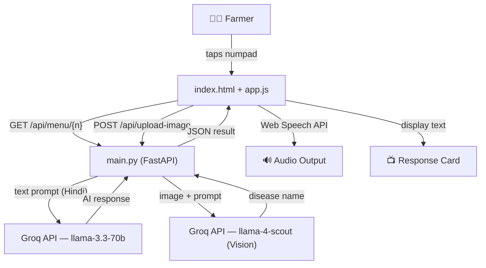

# Kisan Mitra (किसान मित्र) - Digital Farming Assistant

**Kisan Mitra** is a simple, highly accessible digital assistant designed specifically for farmers. It features an intuitive **numpad-like interface** that allows users to access agricultural information, weather updates, and market prices simply by pressing a number, much like dialing on a basic phone.

## ✨ The Numpad Experience

To make the app as easy to use as possible, the interface is designed around a classic 0-9 numpad. Instead of complex menus or typing, the user just taps a number to get instant AI-generated responses in Hindi. 

* **Select an Option:** Tap a number (e.g., `1` for Wheat crop info, `5` for Weather) and hit `✓` (OK).
* **Clear Input:** Tap `C` to clear the screen.
* **Voice Assistance:** A built-in voice button reads out the menu options so users know exactly which number to press.

## 🚀 Features

- **Zero Learning Curve:** A familiar 12-button numpad interface (0-9, C, ✓).
- **AI-Powered Insights:** Uses Groq's high-speed Llama models to provide tailored, localized answers in Hindi (Devanagari script).
- **Plant Disease Diagnosis:** An image upload feature uses vision AI to analyze plant photos and instantly name the disease in a single Hindi sentence.
- **Audio Feedback:** Text-to-speech features to read out the menu and responses.

## 📁 Folder Structure

```
WEBAPP_python/
├── main.py              # FastAPI backend — routes, API calls, keep-alive task
├── requirements.txt     # Python dependencies
├── .env                 # Groq API key (not committed)
├── .gitignore
└── static/
    ├── index.html       # Main page with the numpad layout
    ├── style.css        # All styling — dark theme, numpad grid, animations
    └── app.js           # Frontend logic — input handling, API calls, TTS
```

## 🏗️ Architecture & Data Flow

The app is a straightforward client-server setup. Here's how everything connects:



### How it works step-by-step

1. The farmer taps a number on the **numpad** and presses **✓**.
2. `app.js` sends a request to the FastAPI backend (`/api/menu/{number}`).
3. `main.py` picks the matching Hindi prompt and forwards it to **Groq's LLaMA model**.
4. The AI response comes back as JSON and gets displayed on screen.
5. The browser's **Web Speech API** reads the response out loud.

For **plant disease detection**, the farmer uploads a photo via option 8. The image is base64-encoded and sent to Groq's vision model, which returns the disease name in Hindi.

## 🛠️ Tech Stack

- **Backend:** Python, FastAPI, Uvicorn
- **Frontend:** Vanilla HTML, CSS (Custom Design System), JavaScript
- **AI Provider:** Groq API (`llama-3.3-70b-versatile` for text, `meta-llama/llama-4-scout-17b-16e-instruct` for vision)

## ⚙️ How to Run Locally

1. **Clone the repository.**
2. **Install dependencies:**
   ```bash
   pip install -r requirements.txt
   ```
3. **Set up environment variables:**
   Create a `.env` file in the root directory and add your Groq API key:
   ```env
   GROQ_API_KEY=your_groq_api_key_here
   ```
4. **Start the FastAPI server:**
   ```bash
   uvicorn main:app --reload
   ```
5. **Open in Browser:**
   Navigate to `http://localhost:8000` to access the numpad interface.
